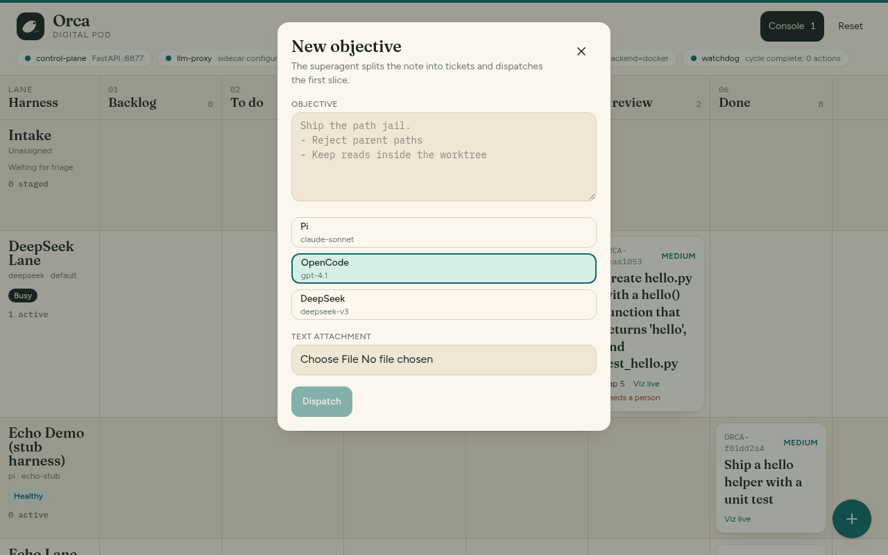
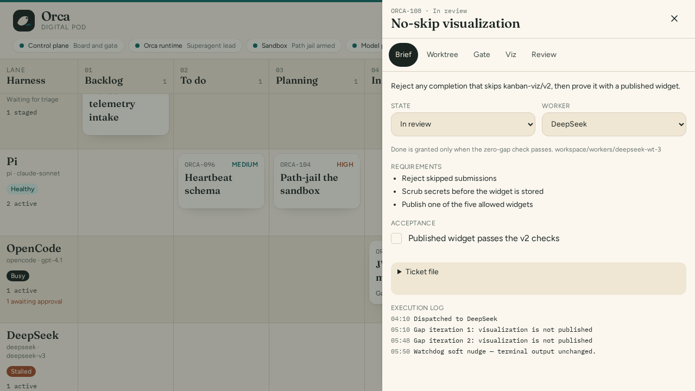
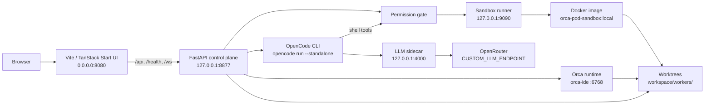

# Orca Digital Pod

Orca Digital Pod is a Kanban control plane for AI coding workers. You submit an objective. The orchestrator turns it into one ticket, assigns a registered worker, and moves that ticket across a six-column board. Each worker is its own row. Shell commands from a worker go through a permission gate and run in a sandbox. A watchdog re-checks work in review and can move a ticket to done when the checks pass.

The board is the product. The processes behind it stay on one Linux machine: a Vite UI, a FastAPI control plane, a Docker sandbox runner, a local LLM sidecar, and the Orca runtime.



*The live board. This shot was taken through a private Tailscale address; that hostname is not a product URL.*

## What you do in the UI

The UI is a single page (`src/routes/index.tsx`). It loads the board from the control plane, listens on `/ws/events`, and also polls `GET /api/board` every 8 seconds.

- **Board.** Columns are Backlog, To do, Planning, In progress, In review, and Done. The first row is Intake (unassigned tickets). Every worker you register adds a row. On a wide screen you can drag a card to another column or another worker.
- **New objective.** The **+** button opens the intake dialog. You write the objective, pick a harness preference, and can attach one text file (`.md`, `.txt`, `.json`, `.py`, `.ts`, `.yml`, `.yaml`, under 200 KB). Dispatch posts to `POST /api/objectives`. The control plane creates **one** ticket. The first line is the title. Later non-empty lines become requirements (if there are none, the requirement is "Complete the stated objective"). A preferred harness is used when a worker of that harness exists; otherwise any registered worker is used. Idle or healthy workers win over busy ones, and a stub worker is skipped when a non-stub worker is free (see Harnesses). If the preferred workers are all busy, the first of them is still assigned. Only an empty worker list leaves the ticket in Backlog.
- **Ticket drawer.** Click a card. Tabs are Brief, Worktree, Gate, Viz, and Review.
  - **Brief** shows the objective, requirements, acceptance checks, text attachments, the ticket file, and the execution log. You can change status or worker here. Moving a card to Done runs the zero-gap check first; a failed check leaves the ticket in review or in progress.
  - **Worktree** lists files from that worker's worktree (dependency directories such as `node_modules`, `.git`, and virtualenvs are skipped) and saves edits through `PUT /api/workspaces/{worker_id}/file`. Paths that leave the worktree are rejected.
  - **Gate** lets you submit a command for that ticket. Low-risk reads can auto-approve. High-risk commands wait.
  - **Viz** edits a published widget. Allowed widgets are `GeoMap`, `GanttChart`, `MermaidDiagram`, `GraphicWalker`, and `AgGrid`. A payload with `skipped: true` is rejected. Secret-shaped strings in the payload are scrubbed before they are stored.
  - **Review** shows gap reports. Its "Run zero-gap" control places the ticket in review. The watchdog grades tickets that are already in review. "Run a cycle" in the console calls `POST /api/watchdog/tick` immediately.
- **Console** (desktop) holds the permission queue (approve or deny), the watchdog (pause, nudge, resume, restart), and **Add a worker**. On a narrow screen the bottom bar splits the first two into Gate and Watch. Adding a worker is on the desktop console.

Register a worker before you expect dispatch to leave Backlog. The harness buttons on New objective only choose among workers that already exist.



*Ticket drawer. Cards in this shot are an example of the layout; a fresh control plane starts with an empty board.*

## How a ticket moves

1. **Intake** writes the ticket (SQLite plus a markdown file under `tickets/`). When a worker is assigned, text attachments are copied into that worker's `.ticket-attachments/` directory and into `ticket-attachments/<ticket-id>/`.
2. When a worker is assigned, the ticket is saved as To do, then Planning. Dispatch marks it **In progress** and starts the harness.
3. A harness run that returns (including the sidecar fallback) moves the card to **In review**. An exception marks the worker stalled and leaves the column unchanged.
4. The watchdog grades in-review tickets. It runs `python3 -m pytest -q` in the worktree when it finds `test_*.py` or a `tests/` directory, through the same permission gate and sandbox. If pytest exits 0, acceptance items are checked off and the ticket moves to **Done**. If there is no pytest suite, the gap stays open (the check asks for tests). A missing visualization is filled with an auto-published Mermaid diagram during this check so the no-skip rule has a widget to store.
5. A failed check increments the gap iteration (cap `MAX_GAP_ITERATIONS`, default 5), sends the worker back to **In progress** with the unmet list, and dispatches again. After the cap, the ticket stays **In review** with `needs_human` set. The drawer says the ticket is waiting on a person.

The watchdog also hashes each busy worker's worktree (paths, sizes, and mtimes, plus any Orca output it can read). When that hash is unchanged and the repeat count is 2, it nudges the worker and marks it stalled. When the worker is busy again and the count is at least 3, it restarts the harness in the same worktree. A nudge leaves the worker stalled, so the restart lands on a later cycle, after the worker is marked busy again. A file change resets the count. Pause supervision from the console to stop the loop. `scripts/start-pod.sh` exports `WATCHDOG_INTERVAL_SEC` defaulting to **20** seconds, which overrides the 30 in `.env.example` and the 180 default on the settings class for processes that script starts.

## Architecture

Everything below is one host. The UI is the only process that listens on all interfaces. The others bind `127.0.0.1`. The browser talks only to the UI; Vite proxies API and websocket traffic to the control plane.



| Process | Bind | Role |
| --- | --- | --- |
| UI | `0.0.0.0:8080` | TanStack Start app. `npm run dev` runs Vite through `scripts/with-app-env.mjs` with `--host 0.0.0.0 --port 8080`. `allowedHosts: true` so a non-local `Host` header (Tailscale MagicDNS, a reverse proxy) is accepted. Proxies `/api` and `/health` to `http://127.0.0.1:8877` and `/ws` to `ws://127.0.0.1:8877`. |
| Control plane | `127.0.0.1:8877` | `uvicorn app.main:app`. Board, intake, ticket edits, worktree files, permission gate, visualization, watchdog loop, websocket `/ws/events`. |
| Sandbox runner | `127.0.0.1:9090` | `python -m sandbox_runner.server`. `POST /exec` runs a command with the worktree mounted at `/work`. |
| LLM sidecar | `127.0.0.1:4000` | `python -m app.llm_proxy`. OpenAI-compatible proxy. Harnesses call it with the dummy token `sk-sidecar-local`. The sidecar adds the real upstream key and forwards to OpenRouter. |
| Orca runtime | `127.0.0.1:6768` | `orca-ide serve --port 6768 --bind 127.0.0.1 --no-pairing`. Optional. Used to register the repo and create worktrees when it is reachable. |

State lives in SQLite at `workspace/.kanban/state.db`. Ticket markdown is `tickets/<id>.md` (see `tickets/TEMPLATE.md`). Attachment bytes are under `ticket-attachments/`. Those paths are gitignored, along with `workspace/`, logs, and `.env`.

### Permission gate and sandbox

`POST /api/permission-gate` classifies a command before anything runs.

- **Low** (auto-approved at the default tier): commands that start with `ls`, `pwd`, `cat`, `head`, `tail`, `wc`, `echo`, `true`, `test`, `pytest`, `python -m pytest`, `python -c`, `git status`, `git diff`, or `git log`.
- **Medium** (`pip`, `npm`, `apt`, `install`, …): runs only when the worker's auto-approve tier covers it, or when the ticket text itself asks for an install or migration. Otherwise it waits on the console.
- **High** (`sudo`, `curl`, `wget`, `ssh`, `rm -rf /`, …): always waits, including when a worker's tier is raised through the API. The console form only offers auto-approve through medium.
- **Path jail**: `..`, `cd /`, and paths under `/etc` or `/root` are denied. The runner also refuses a working directory that is not that worker's directory under `workspace/workers/`.

When Docker is available (`DOCKER_SANDBOX=true`, default, and `/var/run/docker.sock` exists), the command runs in `orca-pod-sandbox:local` with `--memory 512m`, `--pids-limit 256`, and `--network none`. Network is switched to `bridge` only for medium or high commands that contain `pip`, `npm`, `curl`, `wget`, or `uv `. The container does not receive API keys. If the Docker CLI or socket is missing, the runner falls back to a host jail with key, token, and secret variables stripped from the environment. The runner listens at `SANDBOX_EXEC_URL` (`http://127.0.0.1:9090/exec`).

OpenCode shell tools are hooked by `plugins/opencode/sandbox-gate.js`. On dispatch, that file is copied to `~/.config/opencode/plugins/orca-sandbox-gate.js` so `bash` / `shell` calls hit the gate instead of the host shell.

### Harnesses

**OpenCode is the live CLI path.** For a worker whose harness is `opencode`, dispatch runs:

```text
opencode run --standalone --auto --title <ticket-id> <prompt>
```

inside the worktree, with `OPENAI_BASE_URL` pointed at `http://127.0.0.1:4000/v1` and `OPENAI_API_KEY=sk-sidecar-local`. When `ORCA_LLM_API_KEY` or `CUSTOM_LLM_API_KEY` is in the environment, the child also receives `OPENROUTER_API_KEY`. The run times out after 300 seconds. `scripts/start-pod.sh` restarts the OpenCode background service when the `opencode` binary is on `PATH`, so a long-lived `opencode` process sees the key from this start.

If `opencode` is missing, errors, or exits non-zero, dispatch falls back to a small in-process tool loop (`builtin_llm_harness`) that calls the sidecar (`/v1/chat/completions`, up to six JSON steps: write a file, exec through the gate, or done). The model sent as `default` is rewritten to `CUSTOM_LLM_MODEL`.

**Pi and DeepSeek are harness names on the board and in the API** (`pi`, `opencode`, `deepseek`). Dispatch does not start a `pi` or `deepseek` CLI. Those workers use the same sidecar tool loop. `plugins/pi/sandbox_hook.py` and `plugins/deepseek/sandbox_hook.py` can post a command to the gate if you run them yourself; the dispatcher does not install them into the worktree.

The intake dialog shows `claude-sonnet`, `gpt-4.1`, and `deepseek-v3` under the harness names. Dispatch does not send those strings. **Add a worker** stores whatever is in the model field, and that form defaults to the same three strings. Neither path starts a Claude, GPT, or DeepSeek CLI. Upstream model selection for the sidecar is `CUSTOM_LLM_MODEL` (default `openrouter/nvidia/nemotron-3-ultra-550b-a55b:free`). A worker whose model starts with `echo`, or whose name or model contains `stub`, is skipped when another non-stub worker is free.

`FORCE_ECHO_HARNESS=true` forces the labeled echo harness used by tests. It writes a small Python file and a pytest, then runs pytest through the gate. It does not call a model. With no upstream key, the sidecar loop also falls back to that echo harness and says so in the ticket log.

### Orca runtime

When `orca-ide` is on `PATH`, `scripts/start-pod.sh` starts `orca-ide serve`. The control plane will also look for `~/orca-server/bin/orca-ide` when it shells out, but the start script only launches the binary it finds on `PATH`. If the runtime answers, registering a worker tries `orca-ide repo add` and `orca-ide worktree create`. If it does not, the worker still gets a local directory at `workspace/workers/<id>` and the board works. `ORCA_MOCK_MODE=true` skips those CLI calls. The repo does not vendor the `orca-ide` or `opencode` binaries.

### Files that are not the default start path

- `deploy/supervisord.conf` lists the runtime, sidecar, sandbox, and control plane. The start script uses `nohup` instead, and it is what also starts the UI.
- `deploy/litellm-config.yaml` is an optional LiteLLM config. The process on port 4000 is `app.llm_proxy`, not LiteLLM.
- `app/mcp_server.py` exposes `ticket_submit_visualization` and, only if the `mcp` package is installed, a FastMCP tool of the same name. The start script does not launch it.
- `startup.sh` only starts the Vite dev server when port 8080 is down. It does not start the control plane, sandbox, sidecar, or Orca.

## Setup

This is a long-lived multi-process stack, not a Vercel lift-and-shift. Docker workers, SQLite, and local worktrees need an always-on Linux machine. The UI project can still be built with `npm run build` (the Vite config includes a Nitro preset), and a later front door could serve that UI, but the control plane and sandboxes stay on the host.

You need:

- Linux with Python 3 (the script creates `.venv` with `python3 -m venv`), Node.js, and npm
- Docker, if you want the container sandbox. Without the Docker CLI and `/var/run/docker.sock`, commands use the host jail
- `opencode` on `PATH` for the live harness
- `orca-ide` on `PATH` if you want Orca-managed worktrees

The repo does not install `opencode` or `orca-ide` for you.

```bash
git clone <this repo>
cd <repo>
npm install
cp .env.example .env
```

Edit `.env` for ports, paths, `CUSTOM_LLM_ENDPOINT`, and `CUSTOM_LLM_MODEL` if you need to. Leave secrets out of the file. `.env` is gitignored; `.env.example` is the template and contains no key.

Export an OpenRouter key in the shell you use to start the stack. `scripts/start-pod.sh` maps it and does not write it into `.env`:

```bash
export ORCA_LLM_API_KEY='your-openrouter-key'
```

If `ORCA_LLM_API_KEY` is unset, the script uses `CUSTOM_LLM_API_KEY`, then `OPENROUTER_USER_API_KEY`, then `OPENROUTER_API_KEY`, and exports `OPENROUTER_API_KEY` / `OPENROUTER_USER_API_KEY` for OpenCode. Put the key in the environment either way. A value that exists only inside `.env` is visible to the sidecar (pydantic reads the file) and is not exported to the OpenCode process.

Default upstream settings, from the script and `.env.example`:

- `CUSTOM_LLM_ENDPOINT` — `https://openrouter.ai/api/v1`
- `CUSTOM_LLM_MODEL` — `openrouter/nvidia/nemotron-3-ultra-550b-a55b:free`

Start the stack:

```bash
bash scripts/start-pod.sh
```

Re-running it stops pod PIDs recorded under `workspace/.kanban/`, creates `.venv` when `.venv/bin/python` is missing, `pip install`s `requirements.txt`, and builds the sandbox image:

```bash
docker build -t orca-pod-sandbox:local -f deploy/Dockerfile.sandbox deploy
```

The image is `python:3.13-slim-bookworm` plus `git`, `bash`, CA certificates, and `pytest`. A failed build is logged to `workspace/.kanban/docker-build.log` and the script continues. The runner uses that image only when Docker is actually usable. If Docker is up but the image was not built, sandbox commands fail until the image exists.

It then starts, in order: `orca-ide` (when on `PATH`), the LLM sidecar, the sandbox runner, the control plane, and `npm run dev` if nothing is already answering on port 8080. It prints `pod ready` after `GET /health` succeeds on ports 8877, 9090, and 4000. The UI check is separate: if 8080 is already up, the script leaves it alone.

Open `http://127.0.0.1:8080/`. In the console, register a worker with harness **opencode**, then use **+** and Dispatch.

Logs and PIDs:

| File | What |
| --- | --- |
| `workspace/.kanban/control-plane.log` | FastAPI |
| `workspace/.kanban/sandbox-runner.log` | Sandbox runner |
| `workspace/.kanban/llm-proxy.log` | Sidecar |
| `workspace/.kanban/orca-runtime.log` | `orca-ide` |
| `workspace/.kanban/opencode-service.log` | `opencode service restart` |
| `logs/app.log` | Vite, when the start script launched it |

`GET http://127.0.0.1:4000/health` reports whether an upstream key is configured. It does not print the key.

### Tests

Python tests use the echo harness, an in-process sandbox, and a temporary data directory. They do not call OpenRouter.

```bash
.venv/bin/python -m pytest
```

The npm scripts (`npm test`, `npm run typecheck`, `npm run build`) cover the UI toolchain. `npm test` does not run the Python suite.

## Public access

Localhost is enough. Nothing in this repo is a production URL.

The control plane, sandbox, sidecar, and Orca runtime stay on `127.0.0.1`. Only the Vite server listens on `0.0.0.0:8080`. A tunnel or private network in front of port 8080 still reaches the API through that proxy.

These are optional, and none of them is the official address:

- **Tailscale** (or Tailscale Serve) for private access. `allowedHosts: true` is there so MagicDNS hostnames are not rejected. `screenshots/live-board-tailscale.png` is one session viewed that way.
- **Named Cloudflare Tunnel** if you want a stable public hostname. That needs a domain on a Cloudflare account. This repo does not ship a `cloudflared` config.
- **trycloudflare Quick Tunnels** if you want a temporary public URL without a domain. Those hostnames expire.

Do not commit tunnel credentials, Tailscale auth keys, or API keys. The sandbox's scrub list already drops `TAILSCALE_AUTH_KEY` and the LLM keys from command environments.

## What not to commit

`.gitignore` already excludes `.env` (except `.env.example`), `.venv/`, `workspace/` (the SQLite board, worker worktrees, and logs), `ticket-attachments/`, `tickets/*.md` other than `tickets/TEMPLATE.md`, `logs/`, and `*.pid`. Do not add keys, certificates, or a populated worktree to a commit.
